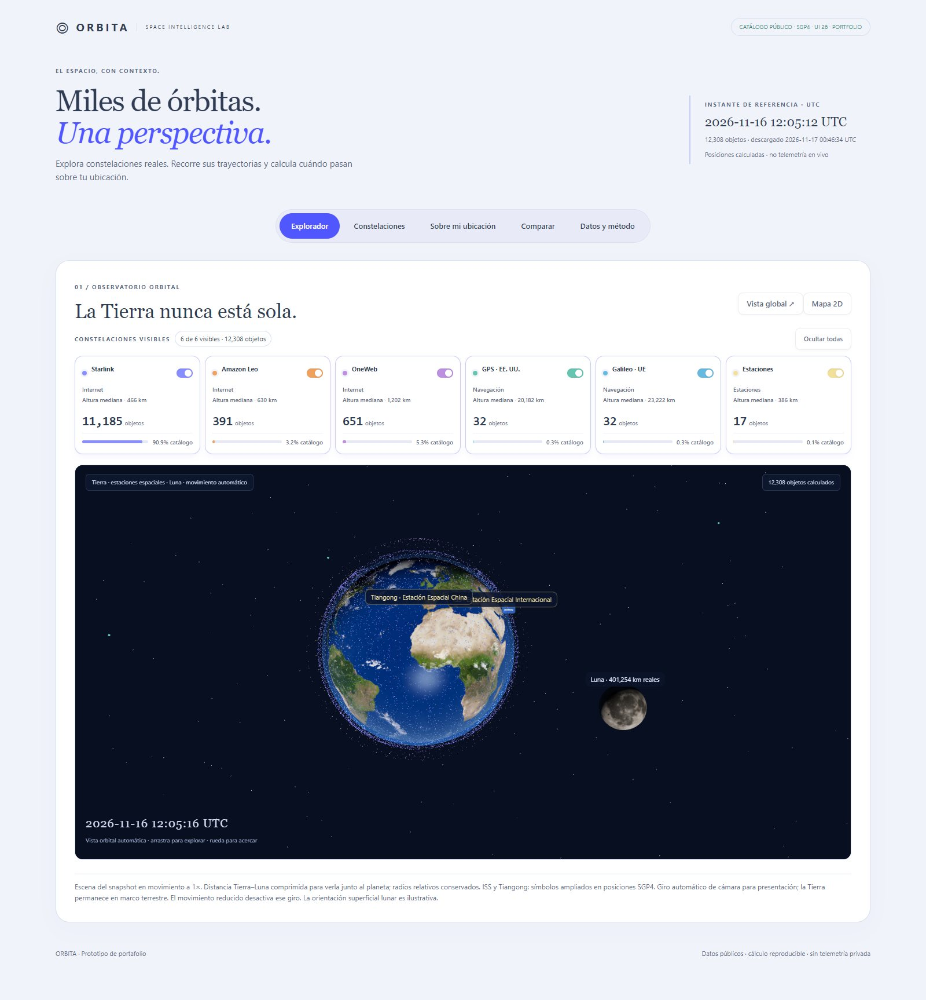

# ORBITA · Inteligencia orbital y visualización geoespacial

Explorador orbital de una sola página: Tierra en 3D, **propagación SGP4 en un Web
Worker**, distribuciones de altura e inclinación, ventanas geométricas y
comparación normalizada de constelaciones sobre un snapshot público de
**12,308 registros**.

[](https://github.com/Dev-HugoAguilar/orbita-orbital-intelligence/actions/workflows/tests.yml)
[](#demo)
[](#datos-y-atribución)

> **Alcance.** Prototipo analítico con snapshot fijo: **no** recibe telemetría en
> vivo y **no** es una herramienta de control de misión. Los conteos pertenecen al
> snapshot descargado, no al presente.

---

## Demo

```bash
git clone https://github.com/Dev-HugoAguilar/orbita-orbital-intelligence.git
cd orbita-orbital-intelligence
python -m http.server 8000 --directory app
```

Abre <http://127.0.0.1:8000/>. No hay compilación, ni dependencias, ni llamadas de
red: la aplicación es un único HTML de 16.7 MB con los datos y las librerías
embebidos.



## Qué demuestra

- **Propagación orbital real, no animación decorativa**: SGP4 sobre los elementos
  del snapshot, ejecutado fuera del hilo principal para no bloquear la interfaz.
- **Lectura por distribuciones**: altura e inclinación por grupo, con conteos y
  comparación normalizada entre constelaciones de tamaño muy distinto.
- **Ventanas geométricas**: un paso geométrico sobre una estación o un punto no
  implica visibilidad óptica, conectividad ni cobertura comercial, y la interfaz
  no lo sugiere.
- **Trazabilidad por fuente**: cada grupo conserva su enlace de origen y su
  SHA-256 declarado en `app/content/orbita.sources.json`.

## Snapshot

| Grupo | Registros |
|---|---|
| Starlink | 11,185 |
| OneWeb | 651 |
| Amazon Leo | 391 |
| Galileo (UE) | 32 |
| GPS (EE. UU.) | 32 |
| Estaciones | 17 |
| **Total** | **12,308** |

Descarga registrada el 2026-11-17; referencia temporal de la simulación
2026-11-16T12:05:12Z.

## Estructura

```text
app/index.html          Aplicación completa: datos, estilos, escena 3D y SGP4
app/content/            Metadatos del proyecto y manifiesto de fuentes (SHA-256)
docs/DISENO.md          Diseño del proyecto y decisiones de lectura
docs/ACEPTACION.md      Criterios con los que se verificó la demo
docs/ENTREGA.md         Nota de entrega
docs/cover.jpg          Captura real de la aplicación servida
```

## Límites

- Snapshot fijo: la precisión depende de los elementos y de su distancia temporal.
- Los 17 registros de estaciones no son 17 estaciones espaciales distintas.
- El relieve es una textura desplazada con exageración, no un DEM calibrado.
- La atmósfera no es un modelo físico validado; la Luna tiene distancia visual
  comprimida y orientación ilustrativa.
- Las estaciones están ampliadas para poder identificarlas; las escalas visuales
  no son métricas.

## Datos y atribución

Snapshot de **CelesTrak** (elementos orbitales públicos) en seis grupos, con
enlace de origen y SHA-256 por grupo. Detalle en `app/content/orbita.sources.json`.
Este repositorio no incluye un archivo `LICENSE` propio: se respetan las
condiciones de las fuentes citadas.

## Seguridad

La aplicación no ejecuta peticiones de red ni procesa datos personales. Reportes
en [`SECURITY.md`](SECURITY.md); convenciones en [`CONTRIBUTING.md`](CONTRIBUTING.md).
